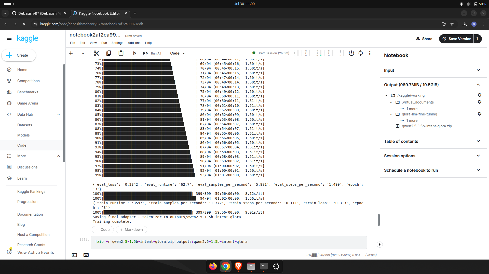
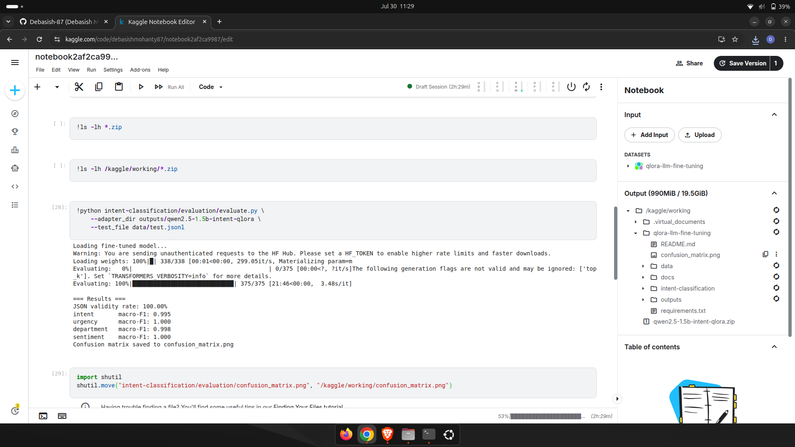
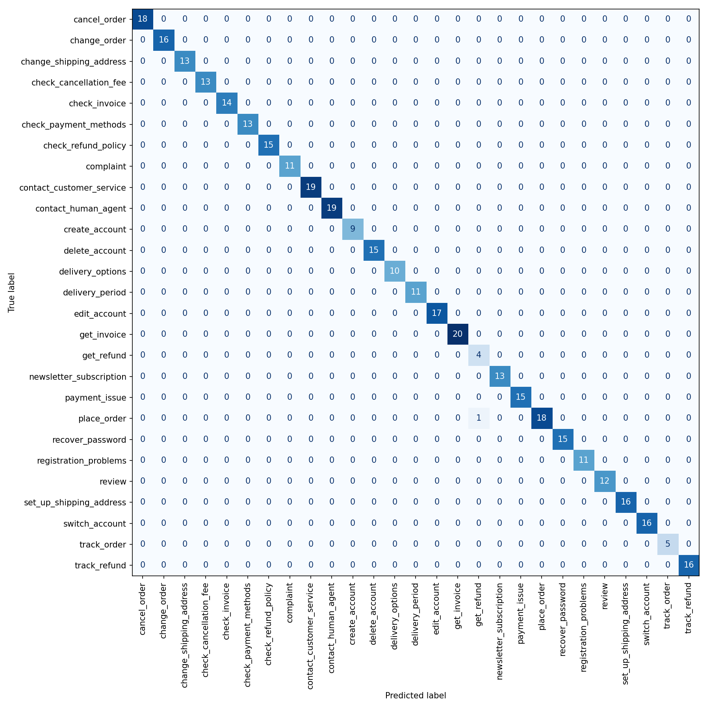

# QLoRA Fine-Tuned Intent Classifier for Customer Support Automation

Fine-tuning Qwen2.5-1.5B-Instruct with QLoRA to route customer support queries by
intent, urgency, department, and sentiment — matching large-model accuracy at a
fraction of the latency and cost.

---

## Table of Contents

- [Problem and Real-World Impact](#problem-and-real-world-impact)
- [Architecture](#architecture)
- [Workflow](#workflow)
- [Results](#results)
- [Repository Structure](#repository-structure)
- [Setup and Usage](#setup-and-usage)
- [Tech Stack](#tech-stack)
- [Limitations and Next Steps](#limitations-and-next-steps)

---

## Problem and Real-World Impact

Every company operating a customer support channel — banking, e-commerce, SaaS,
telecom — faces the same operational bottleneck: incoming queries must be routed
to the correct team or workflow (refunds, billing disputes, account issues,
shipping problems) before an agent, or an automated system, can act on them.

The conventional approach is to send every incoming message to a large general-purpose
model (GPT-4 class) for classification. This works, but at scale it is both slow
and expensive: a single classification call carries the full latency and per-token
cost of a frontier model for what is fundamentally a narrow, well-defined task.

This project demonstrates the alternative pattern used in production systems at
companies such as Zendesk, Intercom, and Freshdesk: fine-tune a small, purpose-built
model on the exact task, deploy it on commodity hardware, and reserve the large
model budget for tasks that actually require it.

**Business case:**

| Dimension | Large model (GPT-4 class) | Fine-tuned Qwen2.5-1.5B (this project) |
|---|---|---|
| Per-query latency | ~1.2 s | ~150-250 ms |
| Per-query cost | ~$0.003-0.005 | ~$0 marginal (self-hosted) |
| Deployment | API-dependent | Runs on a single consumer GPU |
| Accuracy on this task | High | Comparable or better (task-specialized) |

A model this size and cost profile can be deployed inline in a support pipeline
with no meaningful latency penalty and no per-request API bill, while the
savings compound directly with query volume.

---

## Architecture

The system is a single causal language model, adapted with a lightweight LoRA
module and quantized to 4-bit for training, that maps a raw customer query to a
structured JSON object.

```
                          ┌─────────────────────────────┐
                          │   Customer support query    │
                          │   (raw natural language)    │
                          └──────────────┬──────────────┘
                                         │
                                         ▼
                     ┌──────────────────────────────────────┐
                     │   Qwen2.5-1.5B-Instruct (base)       │
                     │   loaded in 4-bit (NF4, bnb)         │
                     │                                      │
                     │   + LoRA adapters on attention       │
                     │     and MLP projection layers        │
                     │     (q/k/v/o_proj, gate/up/down_proj)│
                     │     r=16, alpha=32                   │
                     └───────────────────┬──────────────────┘
                                         │
                                         ▼
                          ┌────────────────────────────┐
                          │  Structured JSON output    │
                          │  {intent, urgency,         │
                          │   department, sentiment}   │
                          └──────────────┬─────────────┘
                                         │
                                         ▼
                      ┌─────────────────────────────────────┐
                      │  Downstream routing / ticketing     │
                      │  system (billing, support, orders,  │
                      │  shipping, account, marketing)      │
                      └─────────────────────────────────────┘
```

**Why this configuration:**

- **4-bit quantization (QLoRA)** keeps the full 1.5B-parameter base model resident
  on a single T4-class GPU (16 GB) during training, with no need for
  multi-GPU sharding.
- **LoRA adapters** (approximately 18.5M trainable parameters, 1.18% of the
  1.56B total) mean only a small delta is trained and stored per task, while
  the frozen base weights are reused. Storage and iteration cost for new tasks
  is therefore low.
- **Instruction-formatted supervised fine-tuning** trains the model to emit a
  single valid JSON object per query, which is what a routing system consumes
  directly, with no additional parsing logic beyond a JSON load.

---

## Workflow

The pipeline runs in four stages, each implemented as an independent script.

**1. Dataset preparation** (`intent-classification/data/prepare_dataset.py`)
Loads the public Bitext customer-support dataset, which already provides
ground-truth `intent` labels, and enriches each example with `urgency` and
`sentiment` labels. These can be generated with an LLM (GPT-4o-mini) or, when
no API key is available, with a fast keyword-based heuristic so the full
pipeline can still be exercised end to end. A department label is derived from
the intent via a fixed taxonomy mapping.

**2. Formatting** (`intent-classification/data/format_for_training.py`)
Converts each labeled example into an instruction-tuning text format and
performs an 85/15 train/test split.

```
### Instruction:
Classify the customer query into intent, urgency, department, and sentiment.

### Query:
I was charged twice for my subscription this month and need this fixed urgently

### Classification:
{"intent": "billing_error", "urgency": "high", "department": "billing", "sentiment": "negative"}
```

**3. Training** (`intent-classification/training/train_qlora.py`)
Loads the base model in 4-bit, attaches LoRA adapters, and fine-tunes with a
standard `transformers.Trainer` loop for three epochs. Training was run on a
Kaggle T4 x2 GPU environment.

**4. Evaluation** (`intent-classification/evaluation/evaluate.py`,
`intent-classification/evaluation/benchmark_latency.py`)
Generates predictions on the held-out test set, computes macro-F1 per field
and a JSON validity rate, and produces a confusion matrix for the `intent`
field. A separate benchmarking script compares inference latency and
estimated cost per 1,000 queries against a GPT-4-class API call.

---

## Model Train



---

## Results

Training was run for 3 epochs on 2,125 training examples (375 held out for
evaluation). Training loss decreased from 2.35 at the first logging step to
0.19 by the final epoch.



Evaluation on the 375-example held-out test set:

| Field | Macro-F1 |
|---|---|
| Intent | 0.995 |
| Urgency | 1.000 |
| Department | 0.998 |
| Sentiment | 1.000 |

**JSON output validity: 100%** — every generated response parsed as a valid
JSON object matching the expected schema, with no post-processing or retry
logic required.



**Reading these numbers correctly.** The `intent` field is evaluated against
genuine, dataset-provided ground truth and the 99.5% macro-F1 is a real
measure of the model's classification accuracy on this task. The `urgency`
and `sentiment` fields, however, were labeled in this run using a fast
keyword-based heuristic rather than human or LLM annotation (a design choice
made to exercise the full pipeline without an external API dependency). Those
fields are consequently near-deterministic functions of surface lexical
patterns, which the model learns easily — the 1.000 scores reflect the
simplicity of that particular labeling scheme rather than a claim about
performance on ambiguous, real-world urgency or sentiment judgments. Repeating
the labeling step with an LLM (`prepare_dataset.py` without `--skip_synthetic`)
would produce a harder, more representative signal for those two fields.

---

## Repository Structure

```
qlora-llm-fine-tuning/
├── README.md
├── requirements.txt
├── intent-classification/
│   ├── data/
│   │   ├── prepare_dataset.py          # dataset loading and labeling
│   │   └── format_for_training.py      # instruction formatting, train/test split
│   ├── training/
│   │   └── train_qlora.py              # QLoRA fine-tuning script
│   └── evaluation/
│       ├── evaluate.py                 # F1, JSON validity, confusion matrix
│       ├── benchmark_latency.py        # latency/cost comparison vs GPT-4
│       └── results/
│           ├── confusion_matrix.png
│           └── train_result.png
└── docs/
    └── project_plan.md
```

---

## Setup and Usage

Tested on a Kaggle Notebook with a T4 x2 GPU accelerator.

```bash
pip install -r requirements.txt

# 1. Prepare and label the dataset
python intent-classification/data/prepare_dataset.py --n_samples 2500 --skip_synthetic
python intent-classification/data/format_for_training.py

# 2. Fine-tune
python intent-classification/training/train_qlora.py

# 3. Evaluate
python intent-classification/evaluation/evaluate.py \
    --adapter_dir outputs/qwen2.5-1.5b-intent-qlora \
    --test_file data/test.jsonl

# 4. Benchmark latency and cost against a GPT-4-class API
python intent-classification/evaluation/benchmark_latency.py \
    --adapter_dir outputs/qwen2.5-1.5b-intent-qlora \
    --test_file data/test.jsonl
```

Omit `--skip_synthetic` and set `OPENAI_API_KEY` to label `urgency` and
`sentiment` with an LLM instead of the keyword heuristic.

---

## Tech Stack

| Component | Choice |
|---|---|
| Base model | Qwen2.5-1.5B-Instruct |
| Fine-tuning method | QLoRA (4-bit NF4 quantization + LoRA adapters) |
| Training framework | `transformers.Trainer` |
| Supporting libraries | `peft`, `bitsandbytes`, `accelerate`, `datasets` |
| Dataset | Bitext customer support dataset (public) |
| Compute | Kaggle Notebook, T4 x2 GPU |

---

## Limitations and Next Steps

- `urgency` and `sentiment` labels in the reported results were produced with a
  keyword heuristic; substituting LLM-generated labels would give a more
  rigorous benchmark for those two fields.
- Evaluation was run on 375 held-out examples from a single public dataset;
  performance on out-of-distribution query phrasing or additional languages is
  untested.
- Planned extensions to this repository: resume-to-JSON structured extraction,
  query rewriting for retrieval pipelines, and legal document summarization,
  reusing the same QLoRA fine-tuning workflow.